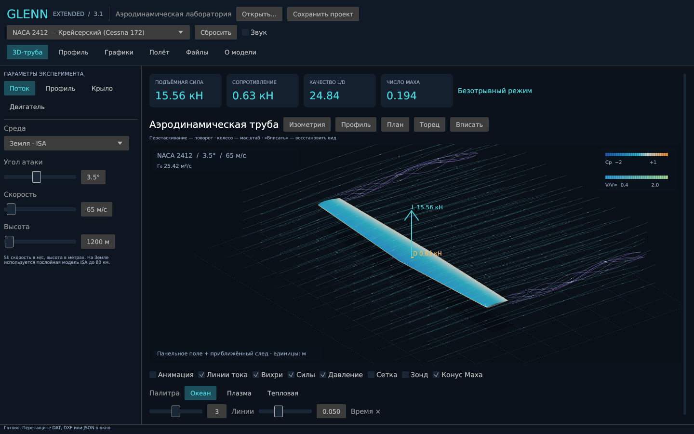

# GLENN FoilSim 3D PRO Extended

> Интерактивный симулятор аэродинамики крыла и механики полёта, основанный на концепциях NASA Glenn FoilSim и EngineSim.

GLENN Extended объединяет численное моделирование обтекания профиля, трёхмерную виртуальную аэродинамическую трубу, расчёт сжимаемости, волнового и индуктивного сопротивления, анализ лётных характеристик и звуковое сопровождение. Меняйте форму крыла, угол атаки, скорость и атмосферу, исследуйте распределение давления и сравнивайте результаты на графиках.

## Скачать и запустить

Готовые приложения доступны в **[последнем релизе](https://github.com/nesfe/GLENN_extended/releases/latest)**.

| Система | Файл | Запуск |
|---|---|---|
| Windows 10/11, x64 | `windows-x86_64.exe` или `.zip` | Запустите EXE; установка не нужна |
| Linux, x64 | `linux-x86_64.tar.gz` | Распакуйте и запустите `./glenn-extended` |
| macOS, Apple Silicon | `macos-aarch64.zip` | Распакуйте и откройте `GLENN Extended.app` |

Архивы сопровождаются контрольными суммами SHA-256. Подробности запуска и системные зависимости — в [руководстве](docs/INSTALL.md).

## Основные возможности

### 1. Вычислительная аэродинамика и физические модели

- **Панельный метод Гесса–Смита:** потенциальное обтекание профиля, локальная скорость и распределение коэффициента давления $C_p(x/c)$; условие Кутты на задней кромке.
- **Крыло конечного размаха:** удлинение, сужение, стреловидность, геометрическая крутка, V-образность и законцовки. Оценки индуктивного сопротивления и эффективности Освальда; распределение нагрузки и циркуляции по размаху.
- **Сжимаемость:** поправка Прандтля–Глауэрта, оценка критического числа Маха и волнового сопротивления.
- **Срыв потока:** изменение подъёмной силы, дополнительное сопротивление и приближённый средний дефицит скорости в следе.
- **Эффект Магнуса:** вращающийся цилиндр, изменение циркуляции, давления и подъёмной силы при изменении оборотов.

### 2. Интерактивная 3D-аэродинамическая труба

- Линии тока и движущиеся частицы, рассчитанные по полю скоростей вокруг профиля. Изменение угла атаки и геометрии меняет обтекание.
- Приближённый концевой вихревой след, связанный с циркуляцией и положением законцовок; направление вращения меняется со знаком подъёмной силы.
- Цветовая карта давления по поверхности крыла, освещение и корректное перекрытие объектов по глубине.
- Векторы подъёмной силы и сопротивления, каркасная сетка, ракурсы «Изометрия», «Профиль», «План» и «Торец».
- Геометрический конус Маха для сверхзвуковых режимов.
- Виртуальный зонд: локальная скорость из того же поля, что и линии тока, число Маха, оценка статического, динамического и полного давления.

### 3. Инженерный 2D-анализ профиля

- Контур, хорда, средняя линия кривизны и центр давления.
- Векторы нормальных сил давления и разрежения.
- Эпюры $C_p$ по верхней и нижней поверхностям.
- Параметрические семейства профилей, механизация и загрузка собственных координат.

### 4. Планетарные атмосферы и другие среды

- **Земля:** стандартная атмосфера ISA с высотными слоями до 80 км.
- **Марс, Венера и Титан:** приближённые модели атмосферы.
- **Вода:** расчёт для подводных крыльев.
- **Пользовательская среда:** ручное задание плотности и скорости звука.

### 5. Механика полёта и силовая установка

- Турбовентиляторный, турбореактивный, поршневой, электрический и ракетный двигатели.
- Скорость сваливания, наивыгоднейшая скорость планирования и максимальное аэродинамическое качество.
- Потребная мощность, скороподъёмность, угол набора высоты и практический потолок.
- Тяговооружённость и баланс располагаемой и потребной тяги.
- Дальность и продолжительность по Брегé для реактивных двигателей.

### 6. Аэродинамические поляры и графики

- Распределение $C_p(x/c)$.
- Поляра $C_L(C_D)$ и текущая рабочая точка.
- Зависимости подъёмной силы и сопротивления от угла атаки.
- Нагрузка и циркуляция по размаху крыла.

### 7. Звуковое сопровождение

Процедурный шум потока зависит от скорости; при срыве появляется низкочастотный рокот. Громкость регулируется, звук можно отключить.

### 8. Импорт и экспорт

- **DAT:** импорт профилей Selig и Lednicer, экспорт координат Selig.
- **DXF:** импорт профиля из чертежа ASCII DXF — `LWPOLYLINE`, `POLYLINE`/`VERTEX` и `SPLINE` (по контрольным точкам либо точкам прохождения). Дуги bulge разворачиваются в отрезки. Линии построения, размеры, подписи и рамка чертежа игнорируются; из нескольких контуров берётся профиль. Масштаб и положение чертежа произвольны: хорда и кривизна отсчитываются от носка.
- **OBJ и STL:** экспорт замкнутой трёхмерной сетки крыла.
- **CSV:** экспорт аэродинамической поляры для таблиц и дальнейшего анализа.
- **JSON:** сохранение проекта, обмен параметрами и загрузка проектов v2.
- Перетаскивание файлов в окно, автосохранение и десять готовых пресетов.

## О расчётной модели

Приложение предназначено для обучения и сравнительных экспериментов. Панельное решение описывает невязкое потенциальное обтекание; конечное крыло, срыв и вихревой след используют инженерные приближения. Это не трёхмерный расчёт турбулентности. После срыва и при $M>0{,}75$ давление и силы нельзя считать количественно достоверными.

Формулы, допущения и проверяемые величины описаны в [численных моделях](docs/NUMERICS.md). Проект вдохновлён NASA Glenn FoilSim и EngineSim и не является официальным продуктом NASA.

## Разработка

Сборка из исходного кода, архитектура и проверки: [руководство разработчика](docs/ARCHITECTURE.md), [проверки](docs/VALIDATION.md).

## Автор

**nesfe** — разработка и развитие проекта GLENN Extended.

## Лицензия

[MIT](LICENSE).
