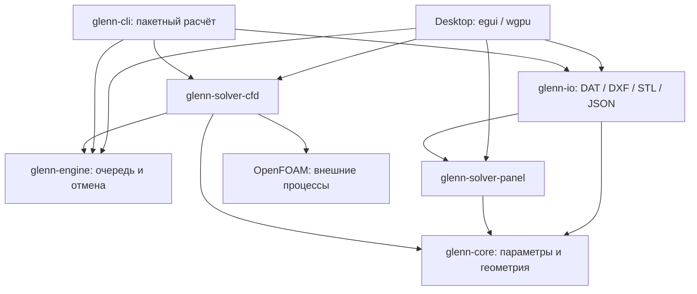

# Архитектура 4.0 beta

Rust workspace разделяет модель данных, численные методы, выполнение задач, файловые форматы и интерфейс. Расчётные пакеты не зависят от egui, wgpu, аудио или файловых диалогов. `src/lib.rs` сохраняет прежние публичные пути для совместимости.



| Пакет | Ответственность |
|---|---|
| `glenn-core` | Единицы и валидация параметров, профили, крыло, замкнутые треугольные тела, BVH для пересечения отрезка с поверхностью |
| `glenn-solver-panel` | Hess–Smith, атмосферы, инженерные поправки конечного крыла, лётные оценки, потенциальное поле и приближённый след |
| `glenn-solver-cfd` | Генерация OpenFOAM case, сетка, вязкий объёмный расчёт, загрузка U/p/ω и сил из одного момента времени |
| `glenn-engine` | Типизированная очередь `Worker<I,O>`, отмена, исключение публикации устаревших результатов |
| `glenn-io` | Чтение/запись файлов; зависимость от panel нужна существующим экспортерам поляры и профиля |
| `glenn-cli` | Программа `glenn-cfd`, использующая тот же адаптер, что Desktop |
| Корневой пакет | Только композиция приложения, управление, сцены, графики и необязательный звук |

## Жизненный цикл расчёта

UI отправляет неизменяемый запрос. У каждого worker одно выполняемое и одно ожидающее задание. Новый ввод заменяет ожидающее задание и отменяет старое. Панельная сетка проверяет отмену между строками, трассировка — между шагами интегрирования. Внешний CFD-процесс получает сигнал остановки; журнал и case сохраняются.

В UI возвращается целый снимок: анализ, лётные оценки, сетка скорости и сцена одного запроса. До его готовности показывается предыдущий снимок с явной подписью. Это исключает смешивание нового значения силы со старой геометрией. UI не ожидает завершения потока при закрытии; worker получает отмену.

`src/ui/jobs.rs` — адаптер панельного режима и импорта. `src/ui/volume.rs` — управление объёмными расчётами. Подготовка STL-сцены также выполняется в фоне. Ошибка импорта показывается отдельным окном, прежняя модель сохраняется. После успешного DXF открывается профиль, после STL — страница CFD.

## Отрисовка

CPU передаёт одну структуру 64 байта на отрезок линии вместо 24 вершин по 56 байт. GPU формирует экранную толщину, сохраняя физические концы отрезка. Это уменьшает объём данных линий в 21 раз; число кадров в секунду зависит от машины и этим отношением не гарантируется. Вершинные и экземплярные буферы переиспользуются.

В панельном режиме маркеры двигаются по интегрированному времени переноса. В CFD показаны мгновенные линии тока последнего сохранённого поля: их нельзя принимать за траектории частиц URANS во времени. Дополнительные точки старта в областях рассчитанной обратной скорости делают замкнутую рециркуляцию видимой. Скорость не изменяется ради рисунка. Пересекающий STL сегмент отсекается по BVH.

## Добавление расчётного модуля

1. Создайте workspace-пакет, принимающий геометрию и явные физические параметры. Не передавайте ему UI-состояние или графический контекст.
2. Определите собственные запрос и результат с единицами, статусом сходимости и областью применимости. Не смешивайте силы одного метода с полем другого.
3. Подключите через `Worker`, проверяя отмену между ограниченными этапами. Добавьте эталонные и инвариантные тесты.
4. Добавьте UI-адаптер и документацию метода. Для внешнего решателя сохраняйте воспроизводимый case и журналы.

Это статические Rust-модули, не система загрузки произвольных динамических плагинов. Общий `Worker` не навязывает одинаковый набор выходов двум физически различным решателям.

## Сборка и проверки

```sh
cargo build --locked --release -p glenn-extended -p glenn-cli
cargo test --locked --workspace --all-targets
cargo clippy --locked --workspace --all-targets -- -D warnings
cargo fmt --all -- --check
```

На Linux для звука нужны заголовки ALSA. Без звука добавьте `--no-default-features`. Численные пакеты можно проверять отдельно без сборки GUI: `cargo test -p glenn-engine -p glenn-solver-cfd -p glenn-io`.

Диагностика окна не затрагивает пользовательские настройки:

```sh
cargo run -- --screenshot artifacts/import.png --input profile.dxf --size 1440x900
cargo run -- --screenshot artifacts/volume.png --cfd-case /path/to/case --scroll-end
```

На Linux без дисплея используйте Xvfb и Mesa Vulkan. Поля OpenFOAM для снимка должны существовать; режим снимков не подставляет демонстрационные CFD-результаты.

В `Cargo.lock` `gpu-allocator 0.27` должен использовать `windows 0.58`, как `wgpu-hal 27`. При обновлении проверяйте Windows-сборку; версии COM-типов нельзя смешивать.
