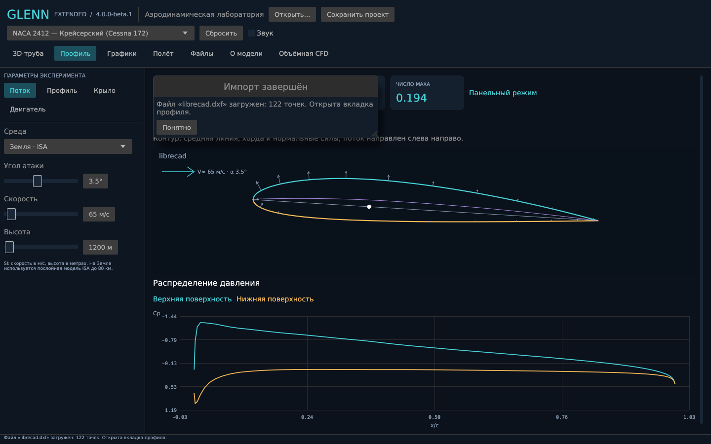
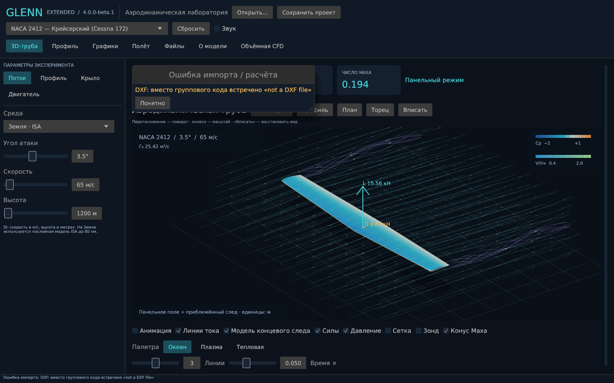
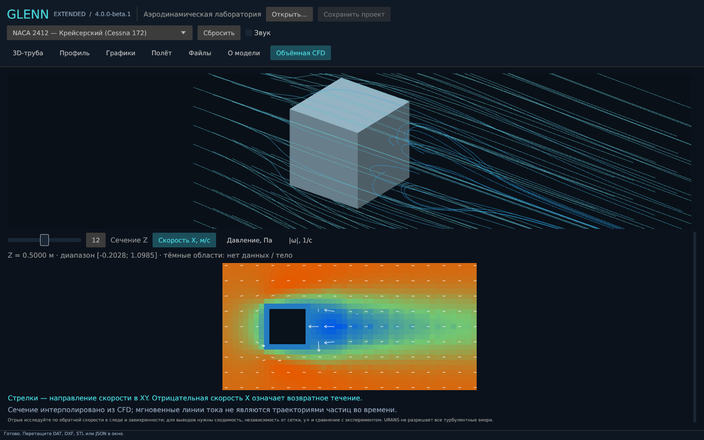

# Проверка 4.0 beta

## Автоматические проверки

```sh
cargo fmt --all -- --check
cargo clippy --locked --workspace --all-targets -- -D warnings
cargo test --locked --workspace --all-targets
```

Для машины без заголовков ALSA используйте `--no-default-features`. Проверять нужно весь workspace: обычный `cargo test` в корне не запускает модульные тесты всех расчётных пакетов.

Локально прошли 49 автоматических тестов; ещё два теста с настоящим OpenFOAM запускаются отдельно командой ниже.

Проверяются:

- прежние физические инварианты: ISA, симметрия и наклон CL, Кутта, Cp/скорость и непротекание, цилиндр Магнуса, нагрузки, единицы TSFC, полное давление, нулевая скорость и кеш геометрии;
- отмена внутри расчёта сетки/линий, отсутствие выдачи частичного решения; очередь заменяет ожидающий запрос и не публикует устаревший;
- файловые форматы, рациональные веса сплайнов, неверные узлы, соединённые DXF LINE, масштаб и положение профиля;
- ASCII/binary STL, включая бинарный заголовок `solid`, физический объём/площадь куба, открытые/вырожденные грани и смешанные нормали;
- импорт через тот же Workbench, что использует окно: DXF с кириллицей и пробелами, подтверждение, переход на профиль, видимая ошибка и сохранение предыдущей модели, переход на CFD после STL;
- отсутствие пересечения основных UI-панелей при шести размерах окна, включая вкладку CFD; физические концы и время линии сохраняются в GPU-данных;
- интерполяция аффинного векторного поля, отсутствие интерполяции через пропущенные данные, BVH-проверка пересечения линии с STL;
- давление из м²/с² переводится в Па, modern force.dat не складывает уже готовую полную силу с её составляющими повторно; поле и силы разных времён отклоняются;
- отмена действительно завершает запущенный процесс, в том числе через bashrc; существующие каталоги расчёта не перезаписываются.

## Настоящий решатель

```sh
OPENFOAM_BASHRC=/usr/lib/openfoam/openfoam2412/etc/bashrc \
  cargo test -p glenn-solver-cfd --test openfoam -- --ignored --nocapture
```

Этот тест помечен `ignored` в стандартном CI, поскольку требует установленного внешнего решателя. Здесь он запускался с OpenCFD OpenFOAM 2412 patch 260127 на Linux. Создаются отдельные каталоги и сохраняются все журналы. Вход — `tests/fixtures/cube.stl`, замкнутый единичный куб. Проверяются laminar, RANS SST, URANS SST, полный путь от STL до U/p/ω и сил; для стационарного ламинарного Re=100 дополнительно проверяется отрицательная Ux за телом. Это функциональная проверка связности расчёта и визуализации, не эталон точности коэффициента сопротивления.

Дополнительный тест Re=1 проверяет достижение сходимости до лимита и согласованность полей/сил на последнем шаге. Исправление внешних граничных условий (`freestreamVelocity` вместе с `freestreamPressure`) позволило получить сходимость на итерации 281 из 500: Fx=0,216850589 Н, |Fy| и |Fz| менее 0,1% Fx. До исправления невязки не сходились даже после 1000 итераций. Эти цифры — регрессия конкретной сетки, не экспериментальный эталон.

Средняя сетка того же куба проверена отдельно: 93 101 ячейка, `Mesh OK`, добавление слоёв завершилось без ошибки. Запрошено 3 слоя; среднее фактическое число по отчёту mesher — 2,45. Этот результат показывает, почему наличие настройки слоёв не гарантирует полное покрытие стенки. При первоначальной проверке средней сетки до исправления внешних граничных условий лимит 200 итераций не дал сходимости; приложение корректно это показало.

Подробная сетка также прошла полный запуск: 489 589 ячеек, `Mesh OK`, 10 итераций и загрузка полей/сил. Короткий запуск проверяет работоспособность, а не сходимость.

## Нативное окно

Диагностический режим запускает обычный импорт и обычные worker. Снимок делается после их завершения, настройки пользователя не читаются и не изменяются.

```sh
xvfb-run -a target/debug/glenn-extended --screenshot /tmp/dxf.png \
  --input profile.dxf --size 1440x900
xvfb-run -a target/debug/glenn-extended --screenshot /tmp/cfd.png \
  --cfd-case /path/to/case --size 1440x900 --scroll-end
```

Проверены подтверждение корректного DXF и явная ошибка повреждённого файла, панельная сцена и срез обратного течения из сохранённого CFD-case. Исходный файл DXF, на котором пользователь наблюдал отказ, не предоставлен; его конкретная причина не установлена.

## Производительность

```sh
cargo run --release --no-default-features --example benchmark
cargo run --release --no-default-features --example interaction
```

`interaction` подаёт 200 изменений угла без ожидания предыдущего решения и проверяет, что получен последний запрос. Локальный замер: 0,134 мс на всю передачу, максимум 0,002 мс на submit; последний результат через 121 мс. Это не замер GPU/FPS и не гарантия для другой машины. В отличие от v3, время вычисления не блокирует цикл интерфейса. Объём данных отрезка уменьшен с 24×56 до 64 байт; общая память кадра включает также поверхность и буферы глубины.

## Неподтверждённые свойства

Пока не выполнены экспериментальная валидация CFD, полная сеточная сходимость, проверка независимости от границ области, статистическая сходимость URANS и физический прогон Windows/WSL. Перечень успешных тестов не даёт основания объявлять программу универсальным проверенным инженерным комплексом. Подробности модели и установки — [CFD.md](CFD.md).

## Снимки проверенного интерфейса

DXF с подтверждением:



Повреждённый файл с явной ошибкой:



Ламинарный куб Re=100, 100 итераций, грубая сетка: качественная иллюстрация рассчитанного обратного течения, без заявления о сошедшемся сопротивлении. Ux достигает −0,203 м/с.


