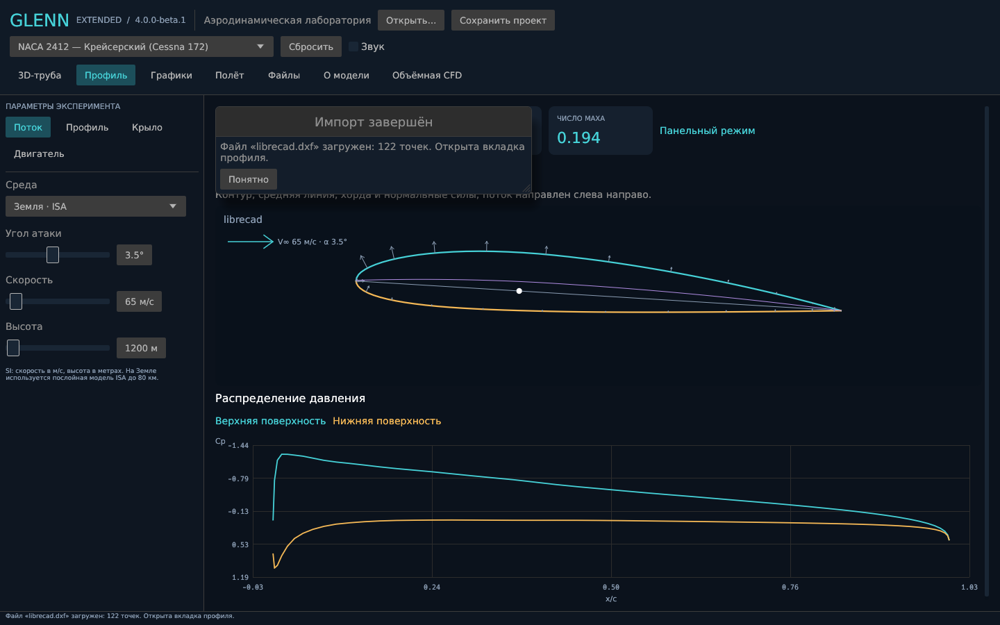
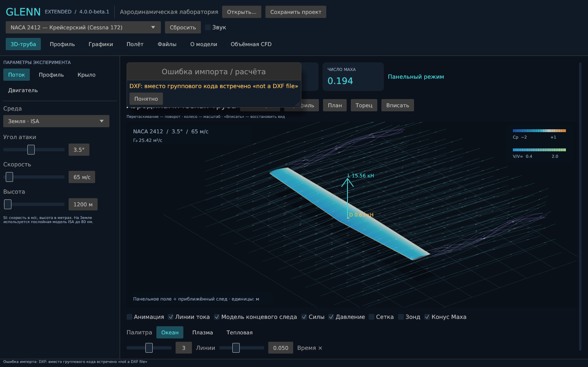
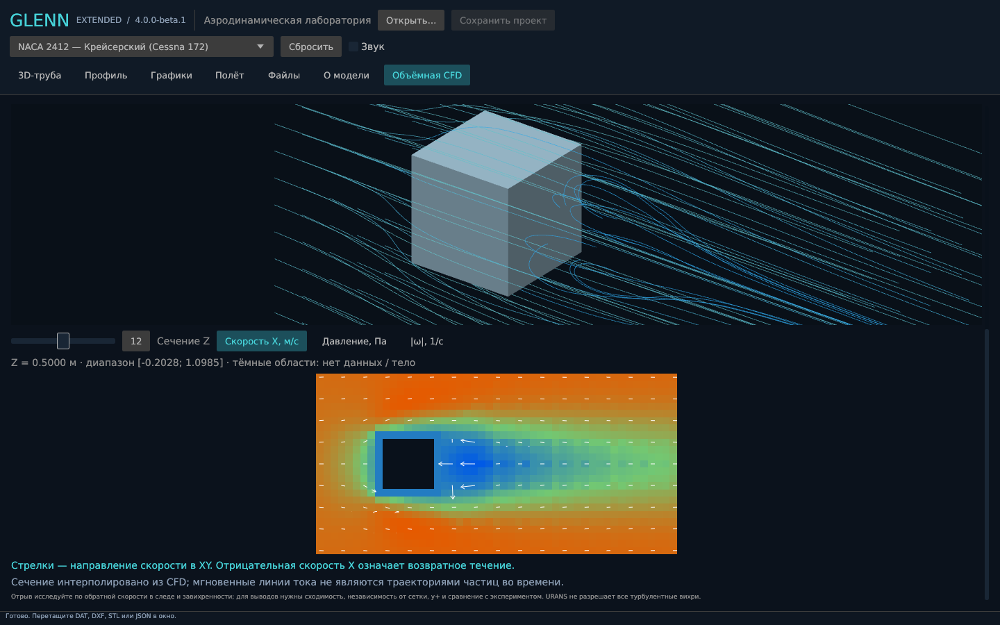
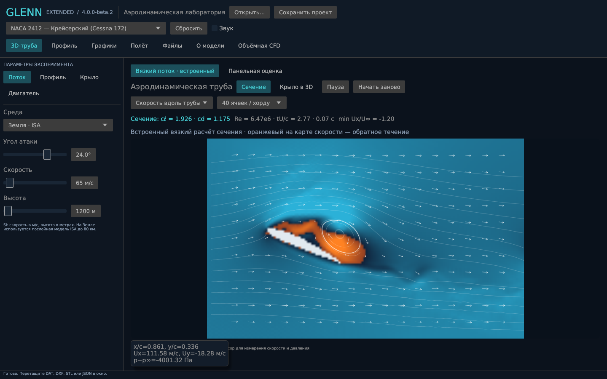
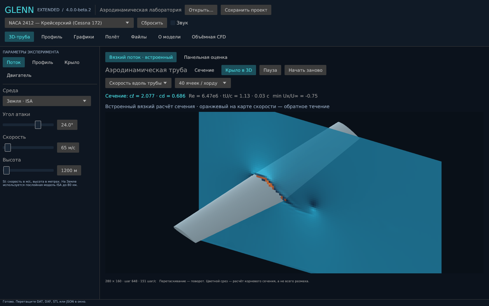
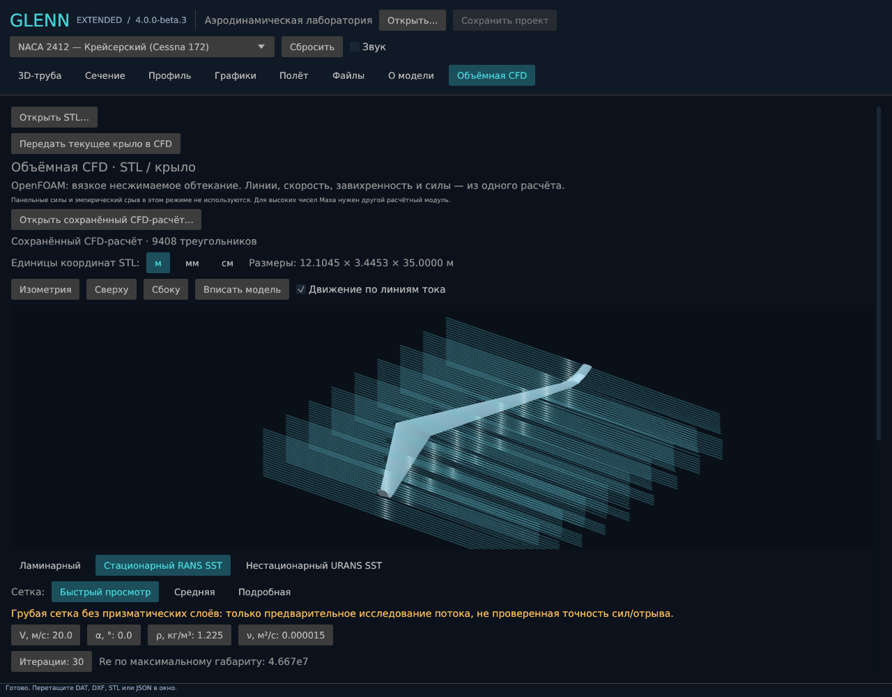
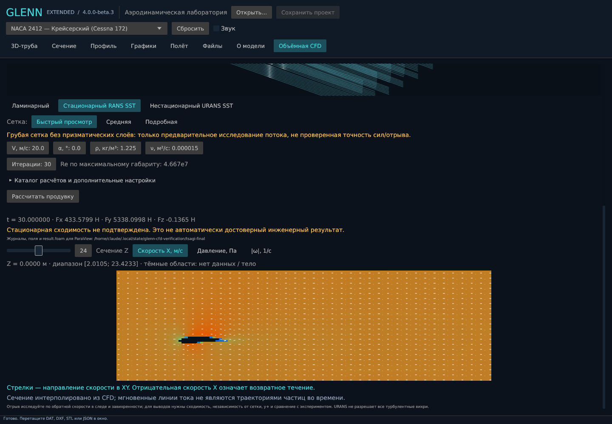
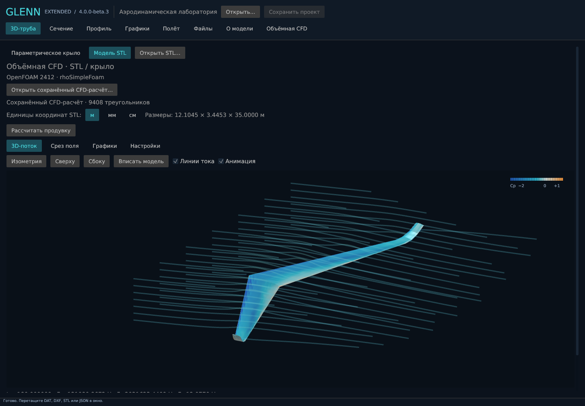
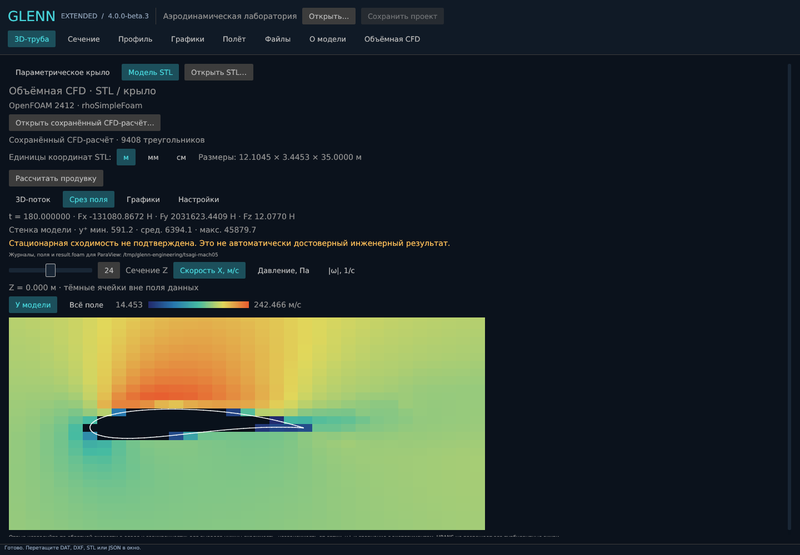

# Проверка 4.0 beta

## Автоматические проверки

```sh
cargo fmt --all -- --check
cargo clippy --locked --workspace --all-targets -- -D warnings
cargo test --locked --workspace --all-targets
```

Для машины без заголовков ALSA используйте `--no-default-features`. Проверять нужно весь workspace: обычный `cargo test` в корне не запускает модульные тесты всех расчётных пакетов.

CI запускает весь workspace. Два дополнительных теста OpenFOAM помечены ignored и запускаются отдельно командой ниже. Помимо них, обязательная проверка упаковки запускает настоящий комплектный решатель на Windows и Linux во всех трёх режимах, включая повторный прогон из распакованного релизного архива в пути с кириллицей и пробелами.

Проверяются:

- прежние физические инварианты: ISA, симметрия и наклон CL, Кутта, Cp/скорость и непротекание, цилиндр Магнуса, нагрузки, единицы TSFC, полное давление, нулевая скорость и кеш геометрии;
- отмена внутри расчёта сетки/линий, отсутствие выдачи частичного решения; очередь заменяет ожидающий запрос и не публикует устаревший;
- файловые форматы, рациональные веса сплайнов, неверные узлы, соединённые DXF LINE, масштаб и положение профиля;
- ASCII/binary STL, включая бинарный заголовок `solid`, физический объём/площадь куба, открытые/вырожденные грани и смешанные нормали;
- импорт через тот же Workbench, что использует окно: DXF с кириллицей и пробелами, подтверждение, переход на профиль, видимая ошибка и сохранение предыдущей модели, переход на CFD после STL;
- отсутствие пересечения основных UI-панелей при шести размерах окна, включая вкладку CFD; физические концы и время линии сохраняются в GPU-данных;
- интерполяция аффинного векторного поля, отсутствие интерполяции через пропущенные данные, BVH-проверка пересечения линии с STL;
- давление из м²/с² переводится в Па, modern force.dat не складывает уже готовую полную силу с её составляющими повторно; поле и силы разных времён отклоняются;
- отмена действительно завершает запущенный процесс, в том числе через bashrc; существующие каталоги расчёта не перезаписываются.

## Настоящий решатель

```sh
OPENFOAM_BASHRC=/usr/lib/openfoam/openfoam2412/etc/bashrc \
  cargo test -p glenn-solver-cfd --test openfoam -- --ignored --nocapture
```

Этот тест помечен `ignored` в стандартном CI, поскольку требует установленного внешнего решателя. Здесь он запускался с OpenCFD OpenFOAM 2412 patch 260127 на Linux. Создаются отдельные каталоги и сохраняются все журналы. Вход — `tests/fixtures/cube.stl`, замкнутый единичный куб. Проверяются laminar, RANS SST, URANS SST, полный путь от STL до U/p/ω и сил; для стационарного ламинарного Re=100 дополнительно проверяется отрицательная Ux за телом. Это функциональная проверка связности расчёта и визуализации, не эталон точности коэффициента сопротивления.

Дополнительный тест Re=1 проверяет достижение сходимости до лимита и согласованность полей/сил на последнем шаге. Исправление внешних граничных условий (`freestreamVelocity` вместе с `freestreamPressure`) позволило получить сходимость на итерации 281 из 500: Fx=0,216850589 Н, |Fy| и |Fz| менее 0,1% Fx. До исправления невязки не сходились даже после 1000 итераций. Эти цифры — регрессия конкретной сетки, не экспериментальный эталон.

Средняя сетка того же куба проверена отдельно: 93 101 ячейка, `Mesh OK`, добавление слоёв завершилось без ошибки. Запрошено 3 слоя; среднее фактическое число по отчёту mesher — 2,45. Этот результат показывает, почему наличие настройки слоёв не гарантирует полное покрытие стенки. При первоначальной проверке средней сетки до исправления внешних граничных условий лимит 200 итераций не дал сходимости; приложение корректно это показало.

Подробная сетка также прошла полный запуск: 489 589 ячеек, `Mesh OK`, 10 итераций и загрузка полей/сил. Короткий запуск проверяет работоспособность, а не сходимость.

## Нативное окно

Диагностический режим запускает обычный импорт и обычные worker. Снимок делается после их завершения, настройки пользователя не читаются и не изменяются.

```sh
xvfb-run -a target/debug/glenn-extended --screenshot /tmp/dxf.png \
  --input profile.dxf --size 1440x900
xvfb-run -a target/debug/glenn-extended --screenshot /tmp/cfd.png \
  --cfd-case /path/to/case --size 1440x900 --scroll-end
```

Проверены подтверждение корректного DXF и явная ошибка повреждённого файла, панельная сцена и срез обратного течения из сохранённого CFD-case. Исходный файл DXF, на котором пользователь наблюдал отказ, не предоставлен; его конкретная причина не установлена.

## Производительность

```sh
cargo run --release --no-default-features --example benchmark
cargo run --release --no-default-features --example interaction
```

`interaction` подаёт 200 изменений угла без ожидания предыдущего решения и проверяет, что получен последний запрос. Локальный замер: 0,134 мс на всю передачу, максимум 0,002 мс на submit; последний результат через 121 мс. Это не замер GPU/FPS и не гарантия для другой машины. В отличие от v3, время вычисления не блокирует цикл интерфейса. Объём данных отрезка уменьшен с 24×56 до 64 байт; общая память кадра включает также поверхность и буферы глубины.

## Неподтверждённые свойства

Пока не выполнены экспериментальная валидация CFD, полная сеточная сходимость, проверка независимости от границ области, статистическая сходимость URANS и экспериментальная проверка модели срыва обычного режима. Перечень успешных тестов не даёт основания объявлять программу универсальным проверенным инженерным комплексом. Подробности модели и установки — [CFD.md](CFD.md).

## Снимки проверенного интерфейса

DXF с подтверждением:



Повреждённый файл с явной ошибкой:



Ламинарный куб Re=100, 100 итераций, грубая сетка: качественная иллюстрация рассчитанного обратного течения, без заявления о сошедшемся сопротивлении. Ux достигает −0,203 м/с.




## Встроенная вязкая труба beta.2

Проверены однородный поток (масса/скорость), аналитическое затухание сдвиговой волны (ошибка амплитуды <2%), отражение поля симметричного профиля, нулевая подъёмная сила при α=0, смена знака сил при ±24°, отрицательная Ux и движение RK2-линии против набегающего потока в рассчитанной отрывной зоне. Проверены смена generation, SI-единицы CSV и запрет экспорта устаревшего поля. Границы этих проверок: [NATIVE_FLOW.md](NATIVE_FLOW.md).

Для трёхмерной трубы на вязком поле дополнительно проверено: набегающий поток возвращается в систему сечения как (cos α, sin α) при −12/0/18°; тело решателя совпадает с профилем сечения; зона обратного течения в объёмном поле растёт с углом (при 24° более чем вчетверо против 2°), а воздух вдали от крыла остаётся попутным; оторванная обшивка размечается на сорванном крыле и не размечается на обтекаемом.

Ограничение числа Рейнольдса расчёта подтверждено измерением, а не предположением: при 40 ячейках и полётном Re сечение на 4° давало cℓ≈0,1 вместо ≈0,65 и знакопеременное сопротивление; при Re=500 то же сечение на 2° обтекается без отрыва с установившимися cℓ=0,09 и cd=0,20, на 8° отрыв начинается, на 16° развивается. Это качественное низкорейнольдсовое обтекание, а не полётный режим.

Локальные `cargo clippy --locked --workspace --all-targets -- -D warnings` и `cargo test --locked --workspace --all-targets` прошли с включённым аудио. Набор включает проверки размеров окна от 640×480 и импорта через настоящий Workbench. Новая труба не обращается к OpenFOAM.





Для воспроизводимого headless-кадра после заданного числа шагов:

```sh
xvfb-run -a target/release/glenn-extended --screenshot /tmp/tunnel.png \
  --size 1440x900 --alpha 24 --native-steps 1500 --camera 1
xvfb-run -a target/release/glenn-extended --screenshot /tmp/section.png \
  --size 1440x900 --alpha 24 --native-steps 1200 --page 8
```

Точное число шагов на снимке может быть больше порога: счёт продолжается до получения события Screenshot. Это не критерий сходимости.


## Исправленная продувка ЦАГИ — beta.3

Регрессия проверяется на пользовательском «ЦАГИ 846-14 (без прорезей).STL»
через scripts/test_uploaded_stl.py из распакованного пакета. Исходный beta.2
терял тело при построении сетки и выдавал нулевые силы в однородном потоке.
Теперь обязательны непустая стенка body, успешный checkMesh, ненулевые силы,
изменение скорости возле тела и повторное открытие результата.

Linux CI 42052391115, Preview/RANS, 20 м/с, 30 итераций: Fx=433.57994055 Н,
Fy=5338.0997898 Н, Fz=-0.13650286788 Н. Это контрольные значения регрессии
работоспособности, НЕ эталон аэродинамической точности: стационарная сходимость
и сеточная независимость в коротком прогоне не установлены. CheckMesh: максимальная
неортогональность 64.6799°, максимальный перекос 3.33029, Mesh OK.





Первый снимок взят из Linux CI. Второй — локальный снимок того же случая
с теми же силами на шаге 30; диапазон Ux в центральном срезе 2.0105…23.4233 м/с.
Поле и силы относятся к одному времени.

## Сечение NACA 0012 при M = 0,50

Симметричный профиль с закрытой задней кромкой, нулевой угол, Re = 3 000 000. Расчёты начаты с однородного потока. Среднее по времени взято за интервал от 3 до 4 пролётов хорды. Команду можно повторить для каждого N.

```sh
cargo run --release --locked -p glenn-solver-native --example survey -- 0 3000000 40 1 0.5 4
```

| Ячеек на хорду | cd со ступенчатой стенкой | cd с обрезанными ячейками и HLLC |
| ---: | ---: | ---: |
| 24 | 0,223501 | 0,101368 |
| 32 | 0,235854 | 0,075425 |
| 40 | 0,183270 | 0,031963 |

Подъёмная сила симметричного сечения равна нулю до шестого знака на всех трёх сетках. На 40 ячейках расчётное сопротивление уменьшилось на 82,6%. При переходе с 32 на 40 ячеек cd всё ещё меняется на 0,04346. Сеточная независимость сопротивления здесь не достигнута. Для сравнения, при близком к нулю угле в аэродинамической трубе на M = 0,50 и Re = 3 млн измерено cd порядка 0,009 с фиксированным переходом. Встроенное сечение рассчитывалось без принудительного перехода. Эксперимент приведён на рис. 8 отчёта [NASA TM-81927](https://ntrs.nasa.gov/citations/19810014503).

### Объёмная продувка ЦАГИ при 170 м/с

На предварительной сетке сохранены поле скорости, нагрузки и давление на 25 460 гранях стенки на итерации 180. Температура воздуха 288,15 К, угол 12°. Снимки сделаны при проверке до смены номера версии. Оба показывают один и тот же момент. Среднее y⁺ на этой сетке составило 6394.





При продолжении расчёта ЦАГИ на предварительной сетке до итерации 1500 средние Fx и Fy в интервале 1301–1400 составили −48 627 и 1 386 205 Н. В интервале 1401–1500 получено −48 663 и 1 388 108 Н. Это изменение на 0,073% и 0,137% относительно модулей предыдущих средних.

| Сетка при 170 м/с и 12° | Итерация | Сопротивление по потоку, Н | Подъёмная сила поперёк потока, Н |
| --- | ---: | ---: | ---: |
| Предварительная | 900 | 248 737 | 1 430 893 |
| Средняя, 547 685 ячеек | 900 | 251 642 | 1 641 725 |
| Предварительная | 1000 | 245 928 | 1 404 490 |
| Средняя, 547 685 ячеек | 1000 | 249 375 | 1 612 886 |

Здесь силы повёрнуты на угол входного потока. На итерации 1000 изменение сетки даёт разницу в сопротивлении 1,4% и в подъёмной силе 14,8%. На средней сетке на итерации 900 считано 846 206 векторов скорости, минимальная компонента Ux равна −45,96 м/с. Проверка независимости сил от сетки остаётся открытой.
