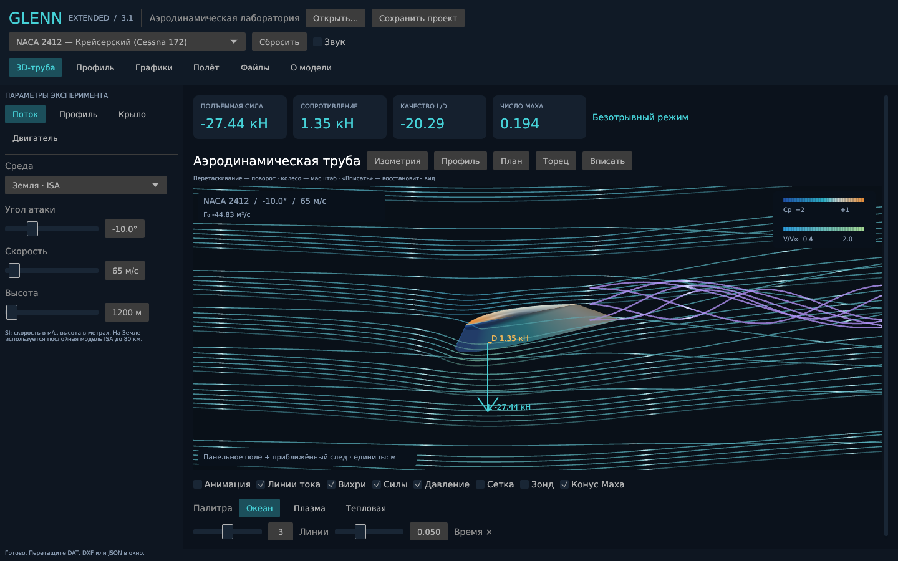
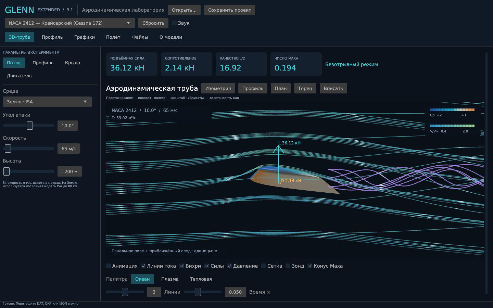

# Проверка версии 3.1.0

## Автоматические проверки

`cargo fmt --all -- --check`, `cargo clippy --locked --all-targets -- -D warnings`, `cargo test --locked --all-targets`.

16 тестов численного ядра и файлов:

- опорные давления ISA и монотонность до 80 км;
- симметрия Cp, знак/наклон CL, равенство давления у задней кромки;
- подъёмная сила и момент изогнутого профиля при нулевом угле;
- все 10 пресетов в каждой из 6 сред;
- интеграл положительной/отрицательной нагрузки по размаху;
- нулевая сила при нулевой скорости и сопротивление неподвижного цилиндра;
- кеш геометрии при изменении угла и среды;
- формула Пито при M=2 и непрерывность при M=1;
- независимость Vstall от выбранного текущего угла;
- JSON roundtrip, валидация и сохранение последнего корректного состояния;
- DAT roundtrip и Lednicer с разным числом точек поверхностей;
- DXF-полилиния и отклонение неподдерживаемых дуг;
- миграция TSFC/топлива старых проектов;
- замкнутость сетки, согласованность рёбер и положительный ориентированный объём.

6 тестов поля скоростей:

- нормальная скорость на панелях и совпадение Cp с 1−|V/V∞|² при M=0;
- изменение траекторий при смене угла, неподвижное направление потока вдали от крыла, смена знака фактической поперечной скорости в концевом следе;
- отсутствие пересечения линий с телом (33 контрольные точки на каждом сегменте), монотонное время переноса, совпадение скорости зонда и поля;
- перемещение начала следа вместе со стреловидностью, круткой, V-образностью и законцовкой, отсутствие циркуляции при нулевой подъёмной силе;
- аналитический цилиндр: отсутствие радиальной скорости, интеграл Cp согласован с подъёмной силой Магнуса;
- влияние толщины, кривизны и закрылка на скорость в фиксированной точке.

Всего: 23 теста, включая проверку компоновки.

Один тест интерфейса прогоняет 66 сочетаний страниц/панелей и размеров: 640×480, 800×600, 1280×720, 1440×900, 1920×1080 и логическое пространство 1280×720 при масштабе 150%. Проверяются границы и отсутствие пересечения основных панелей. Для дробного DPI допускается округление края менее чем на одну логическую точку.

## Визуальная проверка

Нативное Linux-приложение запускается в Xvfb с Mesa Vulkan (lavapipe). Снимки всех страниц снимаются сверху и после прокрутки до конца, отдельно проверяются панели параметров и масштаб 150%. Снимки трубы при −10°, 0°, 10° и 22° позволяют сравнить положение профиля, изгиб потока, давление и вихревой след. Диагностические запуски используют отдельное временное хранилище и не изменяют настройки пользователя.

```sh
xvfb-run -a target/release/glenn-extended \
  --screenshot artifacts/overview.png --size 1440x900
xvfb-run -a target/release/glenn-extended \
  --screenshot artifacts/files-bottom.png --size 800x600 --page 4 --scroll-end
```

Индексы страниц: 0 труба, 1 профиль, 2 графики, 3 полёт, 4 файлы, 5 описание, 6 параметры. `--control-tab 0…3` выбирает панель параметров, `--preset 0…9` — пресет, `--scale 1.5` — масштаб интерфейса. Уменьшение окна допускает вертикальную прокрутку; одновременное отображение всех данных на маленьком экране не требуется.

В CI тесты и release-сборка выполняются отдельно на Windows, Linux и macOS. Снимки нативного окна в CI выполняются на Linux. Ручной запуск на физических Windows/macOS устройствах, субъективное качество звука и экспериментальная валидация аэродинамики этим не подтверждаются.

## Производительность

```sh
cargo run --locked --release --example benchmark
```

Диагностика сравнивает полное создание геометрии с полярой и обновление текущего угла в кеше. Это локальные измерения, а не сравнение с v2 и не переносимая гарантия частоты кадров. Счётчик должен показать одну подготовку геометрии на 1000 изменений угла.

## Сравнение углов атаки

Одинаковый пресет и ракурс, изменён только угол атаки. Снимки получены из работающего приложения; это визуальная регрессия, а не экспериментальная валидация модели.

−10°:



+10°:


